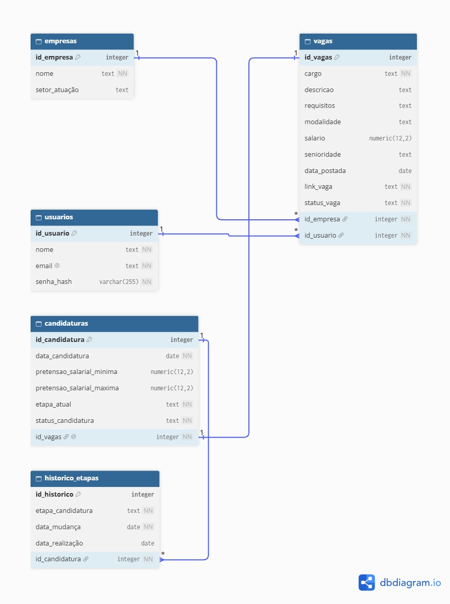

# App Candidaturas 

## Objetivo 

Desenvolver uma aplicação web multiusuário que permita centralizar vagas de emprego, salvar oportunidades de interesse e acompanhar o status das candidaturas de forma individual e organizada.

## Stack

PostgreSQL
| Python
| Git/Github

## Ferramentas

VsCode
| Github Desktop
| Dbdiagram

## Diagrama do banco de dados

  
Visualizar diagrama do banco de dados

  

